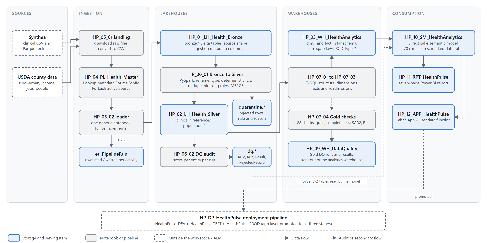

<h1 align="center">HealthPulse</h1>

<p align="center"><strong>End-to-end healthcare data engineering and analytics platform built on Microsoft Fabric</strong></p>

<p align="center">
  
  
  
  
  
</p>

HealthPulse ingests synthetic clinical records and public population-health data, lands them in a Bronze lakehouse, cleans and validates them into Silver with PySpark, builds a dimensional warehouse in T-SQL, and serves historical and operational analytics through a Direct Lake semantic model and a seven-page Power BI report. Every stage is metadata-driven, logged, and checked by a data quality framework whose results are themselves reported.

> All patient records in HealthPulse are synthetic (Synthea). The project contains no real personally identifiable health information.

## Why this project

Most portfolio projects stop at a dashboard. HealthPulse is built the way a production platform is built: reusable ingestion driven by a control table, blocking data quality rules with quarantine instead of silent deletion, Delta Lake MERGE for idempotent loads, surrogate keys and Slowly Changing Dimensions in the warehouse, a measured optimization experiment, and DEV, TEST, and PROD workspaces wired to a deployment pipeline. The report is the last mile, not the point.

## Architecture

<p align="center">
  
</p>

Sources land in Bronze through one metadata-driven loader, are cleaned and validated into Silver by PySpark with quarantine for rejected rows, and are shaped into a star schema in the Gold warehouse with T-SQL. A Direct Lake semantic model serves the report and the Fabric App. Five more diagrams (medallion layers, star schema, pipeline orchestration, data quality flow, environments) and their editable sources are in [architecture/](architecture/).

## What is built

| Layer | Fabric items | What happens there |
|---|---|---|
| Landing | `HP_05_01_NB_SourceIngestion` | Downloads Synthea and USDA files into Bronze `Files/`, converts everything to CSV with ingestion metadata. |
| Bronze | `HP_01_LH_Health_Bronze`, `HP_05_02_NB_MetadataIngestion`, `HP_04_PL_Health_Master` | One generic loader called once per row of `metadata.SourceConfig`. Full or incremental load into `bronze.*` Delta tables. Each activity logs rows read and written to `etl.PipelineRun`. |
| Silver | `HP_02_LH_Health_Silver`, `HP_06_01_NB_BronzeToSilver`, `HP_06_02_NB_BronzeToSilver_DQ`, `HP_06_03_PL_BronzeToSilver` | Thirteen entity transformations behind one registry. Deterministic IDs where the source has none, deduplication, 22 blocking and warning rules, quarantine, Delta MERGE. A separate audit notebook writes the DQ log and score. |
| Gold | `HP_03_WH_HealthAnalytics`, `HP_07_01` to `HP_07_03`, `HP_07_05_PL_SilverToGold` | Eight dimensions and seven facts. Surrogate keys, SCD Type 2 on Patient, Facility, Provider, Payer, a window-function readmission model, incremental update-then-insert loads with validation queries. |
| Gold DQ | `HP_09_WH_DataQuality`, `HP_07_04_NB_SilverToGold_DQ` | 28 checks per run on grain, completeness, uniqueness, SCD2 integrity, and referential integrity. A run fails if any critical check fails. |
| Maintenance | `HP_08_NB_LakehouseOptimization` | OPTIMIZE with V-Order, VACUUM dry run, partition review, before and after measurements logged to `ops.DeltaOptimizationRun`. |
| Semantic model | `HP_10_SM_HealthAnalytics` | Direct Lake over the warehouse and the Silver DQ tables. 20 tables, a dedicated measure table with 70+ measures including prior-year comparisons, marked date table. |
| Report | `HP_11_RPT_HealthPulse` | Seven pages: Executive Overview, Population Health, Clinical Analytics, Utilization, Readmissions, Financial Analytics, Data Quality & Pipeline Health. Custom theme, KPIs with prior-year targets, dynamic titles. |
| App | `HP_12_APP_HealthPulse` + `hp_12_app_healthpulse_connector` | Fabric App backend with a user data function as its data connector. Deployed to all three environments. |
| ALM | `HealthPulse-DEV`, `HealthPulse-TEST`, `HealthPulse-PROD`, `HP_DP_HealthPulse` | Three workspaces on one capacity, promoted through a three-stage Fabric deployment pipeline. |

## By the numbers

Figures measured against the live workspace on 2026-10-09.

| Measure | Value |
|---|---|
| Patients in the warehouse | 1,593,866 |
| Encounters | 15,090,025 |
| Observations | 62,658,749 |
| Conditions, procedures, medication orders | 5.8M, 7.5M, 4.8M |
| Rows written by the ingestion pipeline (all runs) | 1,504,701,785 across 201 logged activities |
| Bronze-to-Silver DQ records evaluated | 144.5M, of which 45.4M quarantined |
| Silver DQ score by entity | 11 of 13 entities at 99.9 or above; Encounter 62.5, USDA People 55.5 |
| Gold DQ, latest run | 28 checks, 27 passed, 1 critical failure (surfaced on purpose) |
| Optimization experiment on `clinical.Encounter` | 200 files to 5 files, benchmark query 4.97 s to 1.95 s |

The two low DQ scores are real findings, not bugs in the framework. Encounter rejections are 45.3M duplicate EncounterIDs created by re-ingesting the same file across pipeline runs; the deduplication rule caught every one. See [documentation/data-quality.md](documentation/data-quality.md).

## Repository map

```
healthpulse-fabric-healthcare/
├── README.md                      this file
├── architecture/                  diagrams as SVG + PNG with their generator scripts (system, medallion, star schema, orchestration, DQ flow, environments)
├── datasets/                      sources, licensing, synthetic-data statement, reproduction
├── pipelines/                     orchestration design + exported pipeline JSON
├── notebooks/                     the nine Fabric notebooks, grouped by layer, with READMEs
├── sql/                           warehouse DDL, dimension loads, fact loads, Gold DQ checks (extracted from the notebooks)
├── semantic-model/                TMDL definition of HP_10_SM_HealthAnalytics
├── powerbi/                       PBIP source of HP_11_RPT_HealthPulse + page guide
├── documentation/                 architecture, data model, data quality, security, optimization, deployment, DP-700 mapping, per-cell notebook docs, warehouse data dictionary
└── screenshots/                   captioned evidence (see screenshots/README.md for the list)
```

## Technology

Microsoft Fabric (OneLake, Lakehouse, Warehouse, Data Factory pipelines, Fabric Apps, deployment pipelines), Apache Spark and PySpark, Delta Lake (MERGE, OPTIMIZE, V-Order, VACUUM), T-SQL, Power BI with Direct Lake and DAX, TMDL, PBIR, Git.

## How to reproduce

1. Create a Fabric workspace on a capacity and name it `HealthPulse-DEV`.
2. Create lakehouses `HP_01_LH_Health_Bronze` and `HP_02_LH_Health_Silver` (schema-enabled) and warehouses `HP_03_WH_HealthAnalytics` and `HP_09_WH_DataQuality`.
3. Import the notebooks from [notebooks/](notebooks/) and attach each to the items listed in its README.
4. Run `HP_05_01_NB_SourceIngestion` once to land the raw files. Sources and licences are in [datasets/README.md](datasets/README.md).
5. Create `metadata.SourceConfig` and `etl.PipelineRun` in the warehouse (DDL in [sql/](sql/) and [pipelines/README.md](pipelines/README.md)) and insert the thirteen source rows.
6. Import the pipeline definitions from [pipelines/exports/](pipelines/exports/) and run `HP_04_PL_Health_Master`, then `HP_06_03_PL_BronzeToSilver`, then `HP_07_05_PL_SilverToGold`.
7. Publish the semantic model from [semantic-model/](semantic-model/) and the report from [powerbi/](powerbi/), or open the PBIP in Power BI Desktop.

A full walkthrough with the order of operations is in [documentation/architecture.md](documentation/architecture.md).

## Lessons learned

- **Measure the source before designing the fact.** The Synthea encounter extract has seven columns. The warehouse fact was designed for class, timing, cost, facility, provider, and payer, so those columns are null and one aggregate table is empty. The gap is documented rather than hidden, and the fix is upstream.
- **Deduplication is only as good as the watermark.** The incremental loader computes a new watermark but never persists it, so re-runs re-ingest whole files. The Silver rule caught 45 million duplicates, which is the framework working, but persisting the watermark removes the cost of catching them.
- **Separate measuring from loading.** Keeping the DQ audit out of the loader made both simpler and made the DQ results reportable.
- **Direct Lake needs its tables published.** Adding a table to the model that is not yet published to OneLake fails the model refresh. Check `Tables/<schema>` in OneLake first.
- **Proxy metrics must say so.** The readmission model uses "any later encounter" because admission and discharge are not in the source. Every measure description and visual caption says this.

## Roadmap

- Persist the incremental watermark back to `metadata.SourceConfig`.
- Enrich the encounter source so facility, provider, payer, timing, and cost columns fill, which also activates `FactFacilityDaily` and the Financial Analytics page.
- Add the planned `DimGeography` from the USDA Silver tables and a population-health page by county.
- Fabric Data Agent over the semantic model with a validation suite ([documentation/ai-validation.md](documentation/ai-validation.md) has the template).
- Row-level security by facility once facility keys are populated.

## Author

Hafizullah Mahmudi. Data engineer working with Microsoft Fabric, Spark, SQL, and Power BI.
