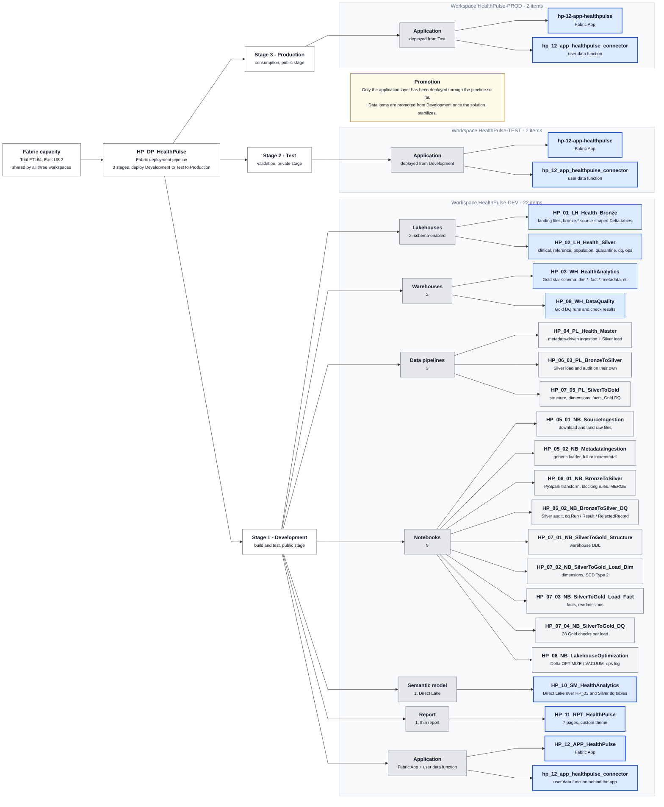
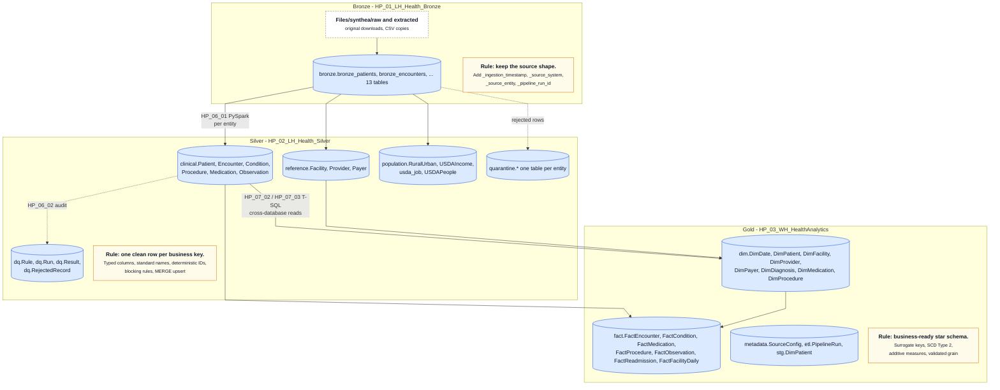
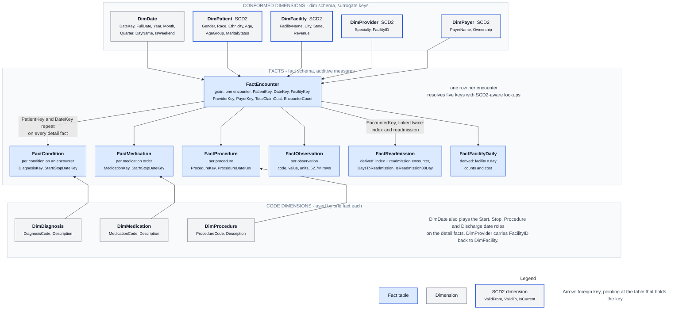
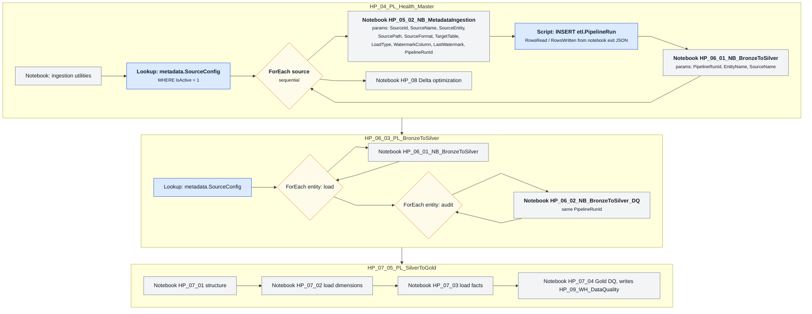

# Architecture diagrams

Seven diagrams, each a plain-text Mermaid file (`*.mmd`). GitHub renders Mermaid inline, so every page that needs a diagram carries the text inside a Mermaid code fence and there are no image files to keep in sync. One visual language throughout: a bold name with a one-line description in each box, grey lanes for layers and workspaces, blue for data stores and serving items, grey for notebooks and pipelines, amber for rules, loops and notes, dashed for things outside the workspace.

| Diagram | Shows | Used in |
|---|---|---|
| [system-architecture.mmd](system-architecture.mmd) | Sources to consumption, every Fabric item in its lane | [README](../README.md), [architecture.md](../documentation/architecture.md) |
| [solution-structure.mmd](solution-structure.mmd) | The full inventory as a tree: capacity, deployment pipeline, stages, workspaces, item groups and every item | [deployment.md](../documentation/deployment.md) |
| [medallion-architecture.mmd](medallion-architecture.mmd) | Bronze, Silver, Gold: the rule each layer enforces, its tables, and the notebooks that move data between them | [architecture.md](../documentation/architecture.md) |
| [data-model.mmd](data-model.mmd) | Star schema overview: conformed dimensions, FactEncounter, the detail facts and code dimensions, SCD2 markers | [data-model.md](../documentation/data-model.md) |
| [data-model-erd.mmd](data-model-erd.mmd) | Column-level entity-relationship diagram: every key, type and SCD2 column | linked from [data-model.md](../documentation/data-model.md) |
| [pipeline-orchestration.mmd](pipeline-orchestration.mmd) | The three pipelines as lanes, with ForEach loops, notebook parameters and the run order | [pipelines/README.md](../pipelines/README.md) |
| [data-quality-flow.mmd](data-quality-flow.mmd) | How a row is standardized, keyed, checked, quarantined, audited and reported, then the Gold checks | [data-quality.md](../documentation/data-quality.md) |

## System architecture

```mermaid
%%{init: {"flowchart": {"curve": "linear", "wrappingWidth": 360, "nodeSpacing": 30, "rankSpacing": 50}}}%%
flowchart LR
    subgraph SRC[Sources]
        S1[Synthea clinical CSV and Parquet]
        S2[USDA county data: rural-urban, income, jobs, people]
    end

    subgraph ING[Ingestion - Fabric Data Factory]
        P0[HP_05_01 download raw files]
        P1["<b>HP_04_PL_Health_Master</b><br/><small>Lookup metadata.SourceConfig, ForEach source</small>"]
        P2["<b>HP_05_02 metadata-driven loader</b><br/><small>Full or Incremental</small>"]
    end

    subgraph BRZ[HP_01_LH_Health_Bronze]
        B1[("<b>bronze.* Delta tables</b><br/><small>raw + ingestion metadata</small>")]
    end

    subgraph SLV[HP_02_LH_Health_Silver]
        T1["<b>HP_06_01 PySpark transform</b><br/><small>rename, type, dedupe, block</small>"]
        T2[HP_06_02 DQ audit]
        B2[(clinical.* reference.* population.*)]
        Q[(quarantine.*)]
        D1[(dq.Rule / Run / Result / RejectedRecord)]
    end

    subgraph GLD[HP_03_WH_HealthAnalytics]
        G1[HP_07_01 structure]
        G2[HP_07_02 dimensions + SCD2]
        G3[HP_07_03 facts + readmissions]
        B3[(dim.* fact.* star schema)]
    end

    subgraph DQW[HP_09_WH_DataQuality]
        D2[(Gold DQ runs and checks)]
    end

    subgraph SRV[Consumption]
        SM["<b>HP_10_SM_HealthAnalytics</b><br/><small>Direct Lake semantic model</small>"]
        RPT["<b>HP_11_RPT_HealthPulse</b><br/><small>7-page Power BI report</small>"]
        APP["<b>HP_12_APP_HealthPulse</b><br/><small>Fabric App + data function</small>"]
    end

    S1 --> P0 --> P1
    S2 --> P0
    P1 --> P2 --> B1
    B1 --> T1 --> B2
    T1 --> Q
    B2 --> T2 --> D1
    B2 --> G1 --> G2 --> G3 --> B3
    G3 -. HP_07_04 checks .-> D2
    B3 --> SM --> RPT
    D1 --> SM
    SM --> APP

    classDef external fill:#ffffff,stroke:#6b7280,stroke-dasharray:4 3,color:#111827
    classDef code fill:#f3f4f6,stroke:#6b7280,color:#111827
    classDef store fill:#dbeafe,stroke:#1d4ed8,color:#111827
    classDef serve fill:#dbeafe,stroke:#1d4ed8,stroke-width:2px,color:#111827
    class S1,S2 external
    class P0,P1,P2,T1,T2,G1,G2,G3 code
    class B1,B2,Q,D1,B3,D2 store
    class SM,RPT,APP serve
```



## Solution structure



## Medallion architecture



## Star schema



## Star schema, column level


## Pipeline orchestration



## Data quality flow

```mermaid
%%{init: {"flowchart": {"curve": "linear", "wrappingWidth": 360, "nodeSpacing": 30, "rankSpacing": 50}}}%%
flowchart LR
    A[("<b>Bronze table</b><br/><small>one entity</small>")] --> B[Rename, cast, standardize]
    B --> C["<b>Build deterministic ID</b><br/><small>SHA-256 of business columns<br/>when the source has no ID</small>"]
    C --> D["<b>keep_latest</b><br/><small>newest ingestion per key</small>"]
    D --> E{"<b>Blocking rules</b><br/><small>DQ001-DQ010 and<br/>DQ_ENTITY validation</small>"}
    E -- valid --> F["<b>Referential check</b><br/><small>PatientID exists in Silver Patient<br/>DQ004 / DQ007</small>"]
    F -- valid --> G[(Silver table<br/>Delta MERGE on key)]
    E -- invalid --> H[(quarantine.Entity<br/>RuleID, Severity, FailureReason,<br/>RunID, FailureTimestamp)]
    F -- orphan --> H

    G --> I["<b>HP_06_02 audit</b><br/><small>same PipelineRunId</small>"]
    H --> I
    I --> J[(dq.Result<br/>one row per applicable rule:<br/>RecordsChecked, RecordsFailed, FailurePct)]
    I --> K[(dq.RejectedRecord<br/>central JSON copy of each rejected row)]
    I --> L[(dq.Run<br/>TotalRecords, ValidRecords,<br/>RejectedRecords, DQScore)]
    J --> M["<b>HP_10 semantic model</b><br/><small>DQRun, DQResult, DQRule tables</small>"]
    L --> M
    M --> N["<b>HP_11 report</b><br/><small>Data Quality & Pipeline Health page</small>"]

    G --> O[HP_07 Gold loads]
    O --> P["<b>HP_07_04 Gold checks</b><br/><small>grain, completeness, uniqueness,<br/>SCD2, referential integrity</small>"]
    P --> Q[(HP_09_WH_DataQuality<br/>SilverToGoldDQRun / Result)]

    classDef code fill:#f3f4f6,stroke:#6b7280,color:#111827
    classDef store fill:#dbeafe,stroke:#1d4ed8,color:#111827
    classDef gate fill:#fffbeb,stroke:#d97706,color:#111827
    classDef reject fill:#fee2e2,stroke:#b91c1c,color:#111827
    classDef serve fill:#dbeafe,stroke:#1d4ed8,stroke-width:2px,color:#111827
    class B,C,D,I,O,P code
    class A,G,J,K,L,Q store
    class E,F gate
    class H reject
    class M,N serve
```



## How to edit

1. Edit the `.mmd` file in any text editor. Paste it into [mermaid.live](https://mermaid.live) for an instant preview, or open a pull request and GitHub renders it in the diff view.
2. Copy the new text into every page listed in the **Used in** column, replacing the body of the matching Mermaid code fence. The pages embed a copy because GitHub does not include one Markdown file in another.
3. Keep the `%%{init}%%` line and the `classDef` lines so new nodes pick up the shared spacing and colours. A box is `Id["<b>Name</b><br/><small>description</small>"]`; assign it to a class with `class Id store` (or `code`, `serve`, `note`).
4. `data-model.mmd` keeps the code dimensions below the facts with invisible `~~~` edges; add the invisible edge first and the visible arrow after it when adding a dimension there.

To export a PNG, for example for the repository social preview, use **Actions > PNG** on mermaid.live, or run the Mermaid CLI (needs Node and a local Chrome or Edge):

```bash
npx -y @mermaid-js/mermaid-cli -i architecture/system-architecture.mmd -o system-architecture.png -b white -s 2
```

`data-model-erd.mmd` is the reference for key names; if a column is renamed in the warehouse, change it there first and then in [warehouse-data-dictionary.md](../documentation/warehouse-data-dictionary.md).

## Change log

### 2026-10-10: restyled diagrams and solution structure tree

- Rebuilt the star schema (`data-model.mmd`) in the original lane design: conformed dimensions, facts and code dimensions as lanes, bold names with a description line, blue facts, grey dimensions, SCD2 marks, edge notes and a legend. The column-level entity-relationship diagram is kept as `data-model-erd.mmd`.
- Added `solution-structure.mmd`: capacity, the HP_DP_HealthPulse deployment pipeline, its three stages, the workspace under each stage, item groups and every item. Built from the live workspace inventory. It replaces `environments.mmd` on the deployment page.
- Applied the same bold-name-plus-description boxes and shared spacing to the system, medallion, pipeline and data quality diagrams.
- Refreshed every inline Mermaid block in `README.md`, `documentation/` and `pipelines/README.md` from the sources, and updated this page's table and editing notes for seven diagrams.

### 2026-10-09: Mermaid replaces SVG and PNG

- Replaced the generated SVG and PNG files and their Python generator scripts with Mermaid text that GitHub renders inline.
- Gave the five flowcharts one colour scheme: blue for data stores and serving items, grey for notebooks and pipelines, amber for rules, loops and notes, dashed for things outside the workspace.
