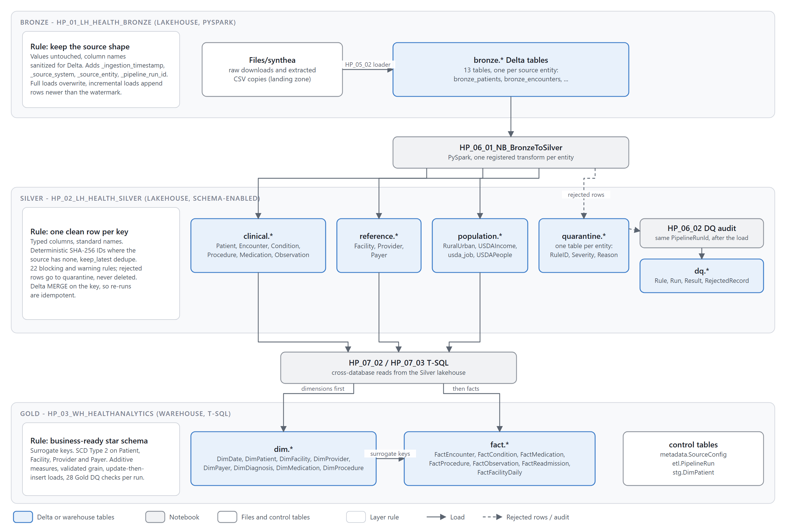
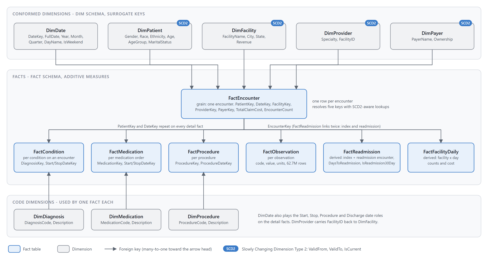
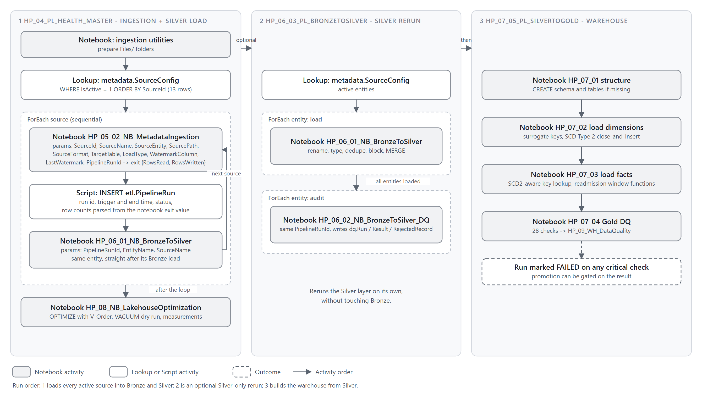
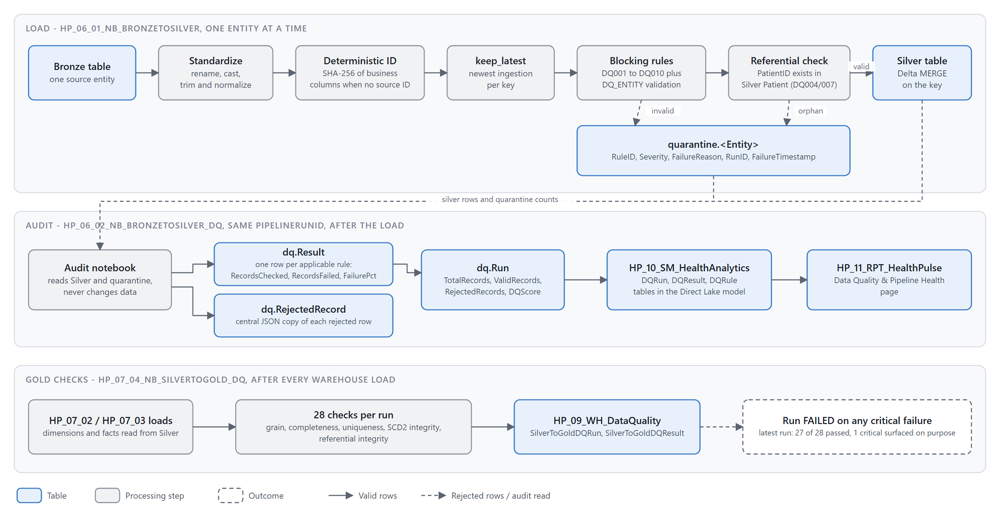
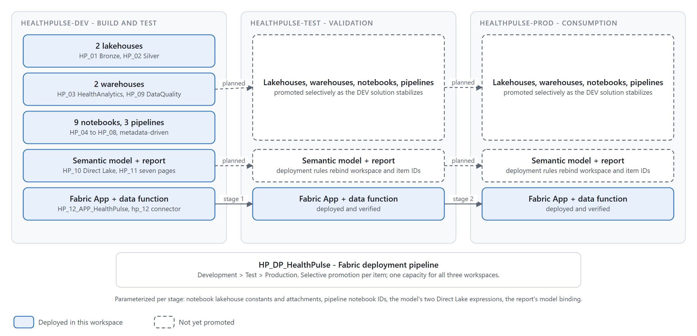

# Architecture diagrams

Six diagrams, each kept as an editable SVG and a 2x PNG export, drawn in one visual language: grey lanes for layers or workspaces, rounded nodes with a bold name and a one-line description, blue for tables and serving items, grey for notebooks and pipelines, dashed for things outside the workspace. Every diagram carries its own legend.

| Diagram | Shows | Used in |
|---|---|---|
| [system-architecture](system-architecture.svg) ([png](system-architecture.png)) | Sources to consumption, every Fabric item in its lane, the deployment pipeline underneath | [README](../README.md), [architecture.md](../documentation/architecture.md) |
| [medallion-architecture](medallion-architecture.svg) ([png](medallion-architecture.png)) | Bronze, Silver, Gold: the rule each layer enforces, its tables, and the notebooks that move data between them | [architecture.md](../documentation/architecture.md) |
| [data-model](data-model.svg) ([png](data-model.png)) | Star schema overview: conformed dimensions, FactEncounter, the detail facts and code dimensions, SCD2 markers | [data-model.md](../documentation/data-model.md) |
| [pipeline-orchestration](pipeline-orchestration.svg) ([png](pipeline-orchestration.png)) | The three pipelines as lanes, with ForEach loops, notebook parameters and the run order | [pipelines/README.md](../pipelines/README.md) |
| [data-quality-flow](data-quality-flow.svg) ([png](data-quality-flow.png)) | How a row is standardized, keyed, checked, quarantined, audited and reported, then the Gold checks | [data-quality.md](../documentation/data-quality.md) |
| [environments](environments.svg) ([png](environments.png)) | DEV, TEST, PROD, what is deployed where, and the deployment pipeline stages | [deployment.md](../documentation/deployment.md) |












## How to edit

The SVGs are generated by small Python scripts in [tools/](tools/), one per diagram, on top of a shared helper (`lib.py`) that draws lanes, nodes, orthogonal edges and legends. Positions are plain numbers, so moving a box or adding one is a one-line change. No packages beyond the standard library are needed; rendering to PNG uses the Chrome or Edge already on the machine.

```bash
cd architecture/tools
python d1_system.py          # rewrites ../system-architecture.svg
python render.py all         # rasterises every SVG to a 2x PNG with headless Chrome or Edge
```

| Script | Output |
|---|---|
| `d1_system.py` | system-architecture |
| `d2_medallion.py` | medallion-architecture |
| `d3_pipelines.py` | pipeline-orchestration |
| `d4_dq.py` | data-quality-flow |
| `d5_env.py` | environments |
| `d6_model.py` | data-model |

The SVGs can also be opened directly in draw.io / diagrams.net, Inkscape or Figma for a one-off tweak. Re-running a script overwrites manual edits, so fold lasting changes back into the script.

## Mermaid sources

The original Mermaid text versions (`*.mmd`) are kept as plain-text alternatives that render inline on GitHub. `data-model.mmd` is the column-level entity-relationship diagram and remains the reference for key names; the others mirror the SVGs at a lower level of detail.
