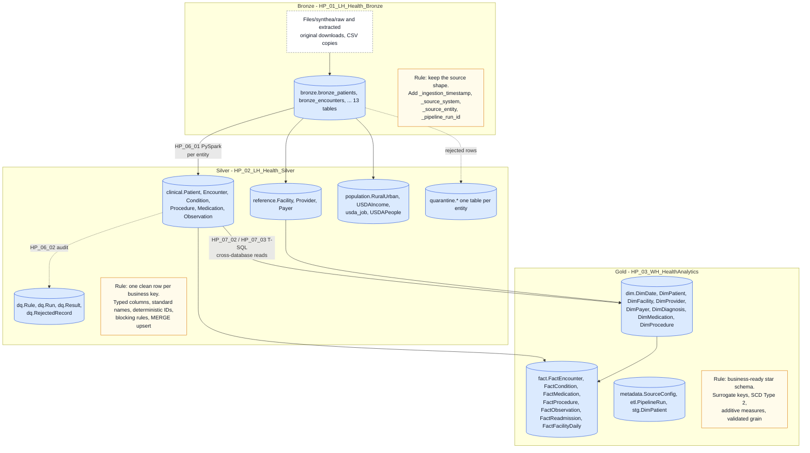
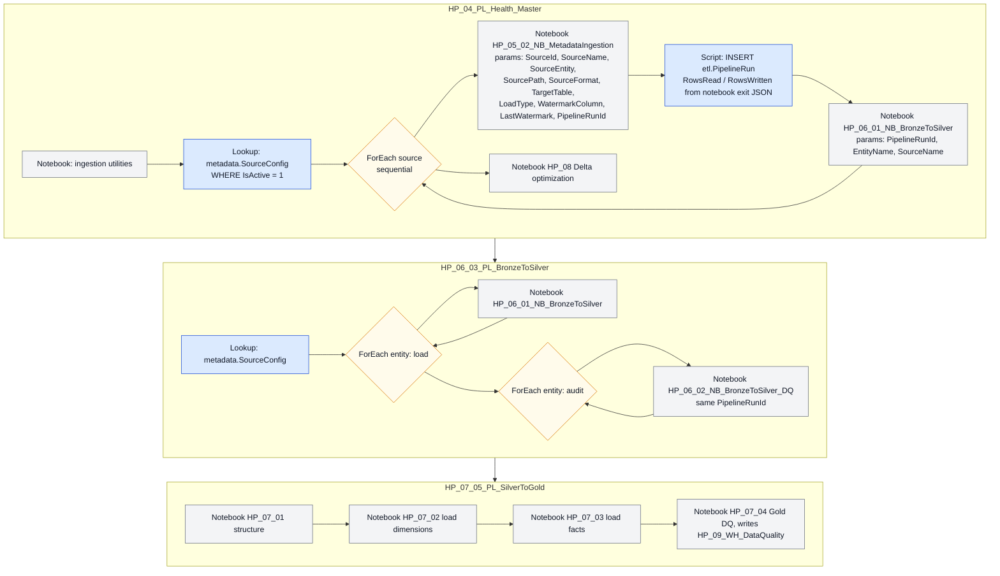
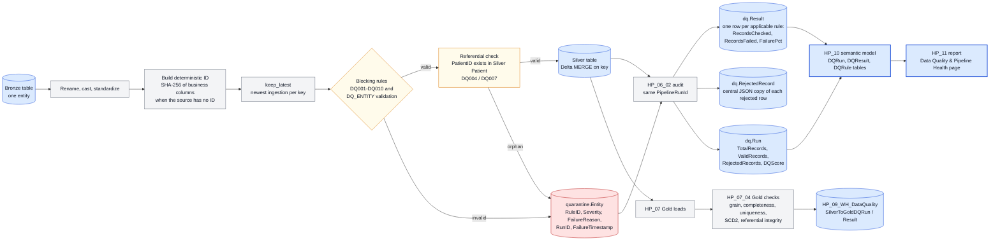
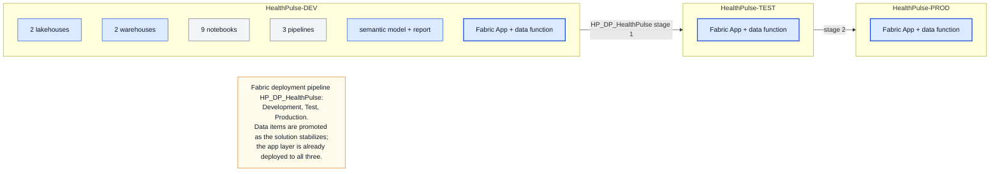

# Architecture diagrams

Six diagrams, each a plain-text Mermaid file (`*.mmd`). GitHub renders Mermaid inline, so every page that needs a diagram carries the text inside a Mermaid code fence and there are no image files to keep in sync. One visual language throughout: blue for data stores and serving items, grey for notebooks and pipelines, amber for rules, loops and notes, dashed for things outside the workspace.

| Diagram | Shows | Used in |
|---|---|---|
| [system-architecture.mmd](system-architecture.mmd) | Sources to consumption, every Fabric item in its lane | [README](../README.md), [architecture.md](../documentation/architecture.md) |
| [medallion-architecture.mmd](medallion-architecture.mmd) | Bronze, Silver, Gold: the rule each layer enforces, its tables, and the notebooks that move data between them | [architecture.md](../documentation/architecture.md) |
| [data-model.mmd](data-model.mmd) | Column-level entity-relationship diagram of the star schema: keys, SCD2 columns, every fact and dimension | [data-model.md](../documentation/data-model.md) |
| [pipeline-orchestration.mmd](pipeline-orchestration.mmd) | The three pipelines as lanes, with ForEach loops, notebook parameters and the run order | [pipelines/README.md](../pipelines/README.md) |
| [data-quality-flow.mmd](data-quality-flow.mmd) | How a row is standardized, keyed, checked, quarantined, audited and reported, then the Gold checks | [data-quality.md](../documentation/data-quality.md) |
| [environments.mmd](environments.mmd) | DEV, TEST, PROD, what is deployed where, and the deployment pipeline stages | [deployment.md](../documentation/deployment.md) |

## System architecture

```mermaid
flowchart LR
    subgraph SRC[Sources]
        S1[Synthea clinical CSV and Parquet]
        S2[USDA county data: rural-urban, income, jobs, people]
    end

    subgraph ING[Ingestion - Fabric Data Factory]
        P0[HP_05_01 download raw files]
        P1[HP_04_PL_Health_Master<br/>Lookup metadata.SourceConfig, ForEach source]
        P2[HP_05_02 metadata-driven loader<br/>Full or Incremental]
    end

    subgraph BRZ[HP_01_LH_Health_Bronze]
        B1[(bronze.* Delta tables<br/>raw + ingestion metadata)]
    end

    subgraph SLV[HP_02_LH_Health_Silver]
        T1[HP_06_01 PySpark transform<br/>rename, type, dedupe, block]
        T2[HP_06_02 DQ audit]
        B2[(clinical.* reference.* population.*)]
        Q[(quarantine.*)]
        D1[(dq.Rule / Run / Result / RejectedRecord)]
    end

    subgraph GLD[HP_03_WH_HealthAnalytics]
        G1[HP_07_01 structure]
        G2[HP_07_02 dimensions + SCD2]
        G3[HP_07_03 facts + readmissions]
        B3[(dim.* fact.* star schema)]
    end

    subgraph DQW[HP_09_WH_DataQuality]
        D2[(Gold DQ runs and checks)]
    end

    subgraph SRV[Consumption]
        SM[HP_10_SM_HealthAnalytics<br/>Direct Lake semantic model]
        RPT[HP_11_RPT_HealthPulse<br/>7-page Power BI report]
        APP[HP_12_APP_HealthPulse<br/>Fabric App + data function]
    end

    S1 --> P0 --> P1
    S2 --> P0
    P1 --> P2 --> B1
    B1 --> T1 --> B2
    T1 --> Q
    B2 --> T2 --> D1
    B2 --> G1 --> G2 --> G3 --> B3
    G3 -. HP_07_04 checks .-> D2
    B3 --> SM --> RPT
    D1 --> SM
    SM --> APP

    classDef external fill:#ffffff,stroke:#6b7280,stroke-dasharray:4 3,color:#111827
    classDef code fill:#f3f4f6,stroke:#6b7280,color:#111827
    classDef store fill:#dbeafe,stroke:#1d4ed8,color:#111827
    classDef serve fill:#dbeafe,stroke:#1d4ed8,stroke-width:2px,color:#111827
    class S1,S2 external
    class P0,P1,P2,T1,T2,G1,G2,G3 code
    class B1,B2,Q,D1,B3,D2 store
    class SM,RPT,APP serve
```



## Medallion architecture



## Star schema

```mermaid
erDiagram
    DimDate ||--o{ FactEncounter : "DateKey"
    DimPatient ||--o{ FactEncounter : "PatientKey"
    DimFacility ||--o{ FactEncounter : "FacilityKey"
    DimProvider ||--o{ FactEncounter : "ProviderKey"
    DimPayer ||--o{ FactEncounter : "PayerKey"

    FactEncounter ||--o{ FactCondition : "EncounterKey"
    FactEncounter ||--o{ FactMedication : "EncounterKey"
    FactEncounter ||--o{ FactProcedure : "EncounterKey"
    FactEncounter ||--o{ FactObservation : "EncounterKey"
    FactEncounter ||--o| FactReadmission : "IndexEncounterKey"
    FactEncounter ||--o{ FactReadmission : "ReadmissionEncounterKey"

    DimPatient ||--o{ FactCondition : "PatientKey"
    DimPatient ||--o{ FactMedication : "PatientKey"
    DimPatient ||--o{ FactProcedure : "PatientKey"
    DimPatient ||--o{ FactObservation : "PatientKey"
    DimPatient ||--o{ FactReadmission : "PatientKey"

    DimDiagnosis ||--o{ FactCondition : "DiagnosisKey"
    DimMedication ||--o{ FactMedication : "MedicationKey"
    DimProcedure ||--o{ FactProcedure : "ProcedureKey"
    DimDate ||--o{ FactCondition : "StartDateKey, StopDateKey"
    DimDate ||--o{ FactMedication : "StartDateKey, StopDateKey"
    DimDate ||--o{ FactProcedure : "ProcedureDateKey"
    DimDate ||--o{ FactObservation : "DateKey"
    DimDate ||--o{ FactReadmission : "DateKey"
    DimDate ||--o{ FactFacilityDaily : "DateKey"
    DimFacility ||--o{ FactFacilityDaily : "FacilityKey"
    DimFacility ||--o{ DimProvider : "FacilityID (natural key)"

    DimDate {
        int DateKey PK
        date FullDate
        int YearNumber
        int MonthNumber
        string MonthName
        string QuarterName
        string DayName
        bit IsWeekend
    }
    DimPatient {
        bigint PatientKey PK
        string PatientID UK
        string Gender
        string Race
        string Ethnicity
        int Age
        string AgeGroup
        string MaritalStatus "SCD2 tracked"
        datetime ValidFrom
        datetime ValidTo
        bit IsCurrent
    }
    DimFacility {
        bigint FacilityKey PK
        string FacilityID UK
        string FacilityName
        string City
        string State
        decimal Revenue
        datetime ValidFrom
        datetime ValidTo
        bit IsCurrent
    }
    DimProvider {
        bigint ProviderKey PK
        string ProviderID UK
        string FacilityID FK
        string Specialty
        datetime ValidFrom
        datetime ValidTo
        bit IsCurrent
    }
    DimPayer {
        bigint PayerKey PK
        string PayerID UK
        string PayerName
        string Ownership
        datetime ValidFrom
        datetime ValidTo
        bit IsCurrent
    }
    DimDiagnosis {
        bigint DiagnosisKey PK
        string DiagnosisCode UK
        string DiagnosisDescription
    }
    DimMedication {
        bigint MedicationKey PK
        string MedicationCode UK
        string MedicationDescription
    }
    DimProcedure {
        bigint ProcedureKey PK
        string ProcedureCode UK
        string ProcedureDescription
    }
    FactEncounter {
        bigint EncounterKey PK
        string EncounterID UK
        bigint PatientKey FK
        int DateKey FK
        bigint FacilityKey FK
        bigint ProviderKey FK
        bigint PayerKey FK
        string EncounterDescription
        string ReasonDescription
        decimal TotalClaimCost
        int EncounterCount
    }
    FactCondition {
        bigint ConditionFactKey PK
        bigint PatientKey FK
        bigint EncounterKey FK
        bigint DiagnosisKey FK
        int StartDateKey FK
        int StopDateKey FK
        int ConditionCount
    }
    FactMedication {
        bigint MedicationFactKey PK
        bigint PatientKey FK
        bigint EncounterKey FK
        bigint MedicationKey FK
        int StartDateKey FK
        int StopDateKey FK
        int MedicationCount
    }
    FactProcedure {
        bigint ProcedureFactKey PK
        bigint PatientKey FK
        bigint EncounterKey FK
        bigint ProcedureKey FK
        int ProcedureDateKey FK
        int ProcedureCount
    }
    FactObservation {
        bigint ObservationFactKey PK
        bigint PatientKey FK
        bigint EncounterKey FK
        int DateKey FK
        string ObservationCode
        string ObservationValue
        float NumericValue
        string Units
    }
    FactReadmission {
        bigint ReadmissionKey PK
        bigint PatientKey FK
        bigint IndexEncounterKey FK
        bigint ReadmissionEncounterKey FK
        int DateKey FK
        date DischargeDate
        date ReadmissionDate
        int DaysToReadmission
        bit IsReadmission30Day
    }
    FactFacilityDaily {
        bigint FacilityDailyKey PK
        int DateKey FK
        bigint FacilityKey FK
        bigint EncounterCount
        bigint ReadmissionCount
        decimal TotalEncounterCost
    }
```



## Pipeline orchestration



## Data quality flow



## Environments



## How to edit

1. Edit the `.mmd` file in any text editor. Paste it into [mermaid.live](https://mermaid.live) for an instant preview, or open a pull request and GitHub renders it in the diff view.
2. Copy the new text into every page listed in the **Used in** column, replacing the body of the matching Mermaid code fence. The pages embed a copy because GitHub does not include one Markdown file in another.
3. Keep the `classDef` lines at the bottom of each file so new nodes pick up the shared colours.

To export a PNG, for example for the repository social preview, use **Actions > PNG** on mermaid.live, or run the Mermaid CLI (needs Node and a local Chrome or Edge):

```bash
npx -y @mermaid-js/mermaid-cli -i architecture/system-architecture.mmd -o system-architecture.png -b white -s 2
```

`data-model.mmd` is the reference for key names; if a column is renamed in the warehouse, change it there first and then in [warehouse-data-dictionary.md](../documentation/warehouse-data-dictionary.md).
