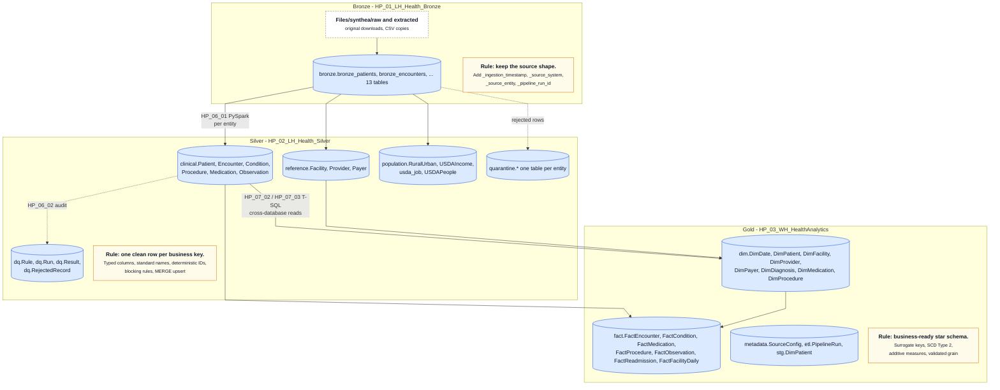

# Architecture

## Purpose

HealthPulse exists to answer two kinds of healthcare questions from one governed platform: historical questions such as patient volume, common conditions, and 30-day readmission rate, and operational questions such as which groups and periods need attention. Microsoft Fabric was chosen because one capacity provides storage (OneLake), batch processing (Spark and Data Factory), a relational warehouse, a semantic layer, reporting, and application hosting, so the whole platform can be built and operated without stitching services together.

## Logical architecture

```
Sources -> Landing (Files) -> Bronze -> Silver -> Gold warehouse -> Semantic model -> Report / App
                                   |         |            |
                                   |     quarantine   Gold DQ warehouse
                                   |     Silver DQ
                                   +---- run log
```



```mermaid
%%{init: {"flowchart": {"curve": "linear", "wrappingWidth": 360, "nodeSpacing": 30, "rankSpacing": 50}}}%%
flowchart LR
    subgraph SRC[Sources]
        S1[Synthea clinical CSV and Parquet]
        S2[USDA county data: rural-urban, income, jobs, people]
    end

    subgraph ING[Ingestion - Fabric Data Factory]
        P0[HP_05_01 download raw files]
        P1["<b>HP_04_PL_Health_Master</b><br/><small>Lookup metadata.SourceConfig, ForEach source</small>"]
        P2["<b>HP_05_02 metadata-driven loader</b><br/><small>Full or Incremental</small>"]
    end

    subgraph BRZ[HP_01_LH_Health_Bronze]
        B1[("<b>bronze.* Delta tables</b><br/><small>raw + ingestion metadata</small>")]
    end

    subgraph SLV[HP_02_LH_Health_Silver]
        T1["<b>HP_06_01 PySpark transform</b><br/><small>rename, type, dedupe, block</small>"]
        T2[HP_06_02 DQ audit]
        B2[(clinical.* reference.* population.*)]
        Q[(quarantine.*)]
        D1[(dq.Rule / Run / Result / RejectedRecord)]
    end

    subgraph GLD[HP_03_WH_HealthAnalytics]
        G1[HP_07_01 structure]
        G2[HP_07_02 dimensions + SCD2]
        G3[HP_07_03 facts + readmissions]
        B3[(dim.* fact.* star schema)]
    end

    subgraph DQW[HP_09_WH_DataQuality]
        D2[(Gold DQ runs and checks)]
    end

    subgraph SRV[Consumption]
        SM["<b>HP_10_SM_HealthAnalytics</b><br/><small>Direct Lake semantic model</small>"]
        RPT["<b>HP_11_RPT_HealthPulse</b><br/><small>7-page Power BI report</small>"]
        APP["<b>HP_12_APP_HealthPulse</b><br/><small>Fabric App + data function</small>"]
    end

    S1 --> P0 --> P1
    S2 --> P0
    P1 --> P2 --> B1
    B1 --> T1 --> B2
    T1 --> Q
    B2 --> T2 --> D1
    B2 --> G1 --> G2 --> G3 --> B3
    G3 -. HP_07_04 checks .-> D2
    B3 --> SM --> RPT
    D1 --> SM
    SM --> APP

    classDef external fill:#ffffff,stroke:#6b7280,stroke-dasharray:4 3,color:#111827
    classDef code fill:#f3f4f6,stroke:#6b7280,color:#111827
    classDef store fill:#dbeafe,stroke:#1d4ed8,color:#111827
    classDef serve fill:#dbeafe,stroke:#1d4ed8,stroke-width:2px,color:#111827
    class S1,S2 external
    class P0,P1,P2,T1,T2,G1,G2,G3 code
    class B1,B2,Q,D1,B3,D2 store
    class SM,RPT,APP serve
```

The source is [architecture/system-architecture.mmd](../architecture/system-architecture.mmd); see [architecture/README.md](../architecture/README.md) for how to edit it.

## Fabric item map

| Item | Type | Layer |
|---|---|---|
| HP_01_LH_Health_Bronze | Lakehouse (schema-enabled) | Landing files and Bronze tables |
| HP_02_LH_Health_Silver | Lakehouse (schema-enabled) | Silver tables, quarantine, Silver DQ, ops log |
| HP_03_WH_HealthAnalytics | Warehouse | Gold star schema, control and run-log tables |
| HP_09_WH_DataQuality | Warehouse | Gold DQ runs and results |
| HP_04_PL_Health_Master | Pipeline | End-to-end run: metadata-driven ingestion, then invokes the Silver and Gold pipelines, then Delta maintenance |
| HP_06_03_PL_BronzeToSilver | Pipeline | Silver load and audit on their own |
| HP_07_05_PL_SilverToGold | Pipeline | Warehouse structure, dimensions, facts, Gold DQ |
| HP_05_01, HP_05_02 | Notebooks | Landing and Bronze |
| HP_06_01, HP_06_02 | Notebooks | Silver load and Silver DQ |
| HP_07_01 to HP_07_04 | Notebooks (T-SQL) | Warehouse |
| HP_08 | Notebook | Delta maintenance |
| HP_10_SM_HealthAnalytics | Semantic model (Direct Lake) | Semantic layer |
| HP_11_RPT_HealthPulse | Report | Analytics |
| HP_12_APP_HealthPulse, hp_12_app_healthpulse_connector | Fabric App, User Data Function | Application layer |
| HP_DP_HealthPulse | Deployment pipeline | DEV, TEST, PROD promotion |

## Batch path

1. `HP_05_01` lands raw files once and converts them to CSV with ingestion metadata.
2. `HP_04_PL_Health_Master` first runs `HP_05_01` to prepare the landing files, then reads `metadata.SourceConfig` and, for every active source, calls the generic loader `HP_05_02` and logs the result to `etl.PipelineRun`.
3. The master then invokes `HP_06_03_PL_BronzeToSilver`, which loads every entity into Silver with `HP_06_01` and audits every entity with `HP_06_02`. The pipeline can also be run on its own after a rule change.
4. The master then invokes `HP_07_05_PL_SilverToGold`, which creates the warehouse structure if missing, loads dimensions, loads facts, and runs the Gold checks. `HP_08` Delta maintenance runs last.

## Medallion layers



## Bronze

Source-shaped Delta tables, one per source entity, with `_ingestion_timestamp`, `_source_system`, `_source_entity`, `_pipeline_run_id`. Column names are sanitized for Delta but values are untouched. Full-load sources overwrite; incremental sources append rows newer than the watermark column.

## Silver

One clean, typed, deduplicated row per business key, in business-named schemas: `clinical`, `reference`, `population`. Transformation functions are registered per entity. Rows that fail a blocking rule go to `quarantine.<Entity>` with the rule and reason. Valid rows are MERGEd on the key so re-runs are idempotent. A separate audit step writes `dq.Run`, `dq.Result`, `dq.RejectedRecord` and a score per entity per run.

## Gold

A warehouse star schema. Dimensions carry surrogate keys and, for Patient, Facility, Provider, and Payer, SCD Type 2 history. Facts resolve business keys to surrogate keys with an SCD2-aware lookup and are loaded incrementally. `FactReadmission` and `FactFacilityDaily` are derived from `FactEncounter`. A Gold DQ run writes 28 checks per load to the separate `HP_09_WH_DataQuality` warehouse.

## Analytics and application consumption

`HP_10_SM_HealthAnalytics` is a Direct Lake model over the warehouse and the Silver DQ tables, with a dedicated measure table and a marked date table. `HP_11_RPT_HealthPulse` is a seven-page thin report with a custom theme. `HP_12_APP_HealthPulse` is a Fabric App backed by a user data function and is deployed to all three environments.

## Design decisions

| Decision | Why |
|---|---|
| Lakehouse for Bronze and Silver, Warehouse for Gold | Spark is the right tool for file-shaped, schema-varying raw data and row-level validation; T-SQL with MERGE, window functions, and transactions is the right tool for a star schema with surrogate keys and SCD2. This is Microsoft's recommended medallion split in Fabric. |
| One generic loader driven by a control table | Thirteen sources, zero duplicated pipelines. Adding a source is a row. |
| Blocking rules in the loader, measurement in a separate notebook | Bad rows never reach Silver, and the audit has no power to change data. Both are simpler to reason about and test. |
| Deterministic SHA-256 IDs | Several Synthea extracts have no row ID. A hash of the business columns makes re-runs produce the same key, which MERGE needs. |
| Surrogate integer keys and SCD Type 2 | Faster joins in Direct Lake and the ability to report attributes as they were at event time. |
| Separate warehouse for Gold DQ | Audit tables stay out of the analytics warehouse that reports and the semantic model read from. |
| Direct Lake, no import | No scheduled refresh to maintain and no copy of 60 million observation rows. |
| A dedicated measure table in the model | Requested by the project; every measure has a format string, description, and display folder. |

## Environment strategy

Three workspaces, `HealthPulse-DEV`, `HealthPulse-TEST`, `HealthPulse-PROD`, on the same capacity, connected by the Fabric deployment pipeline `HP_DP_HealthPulse` (Development, Test, Production). See [deployment.md](deployment.md).

## Known gaps

Documented in the README and in [data-quality.md](data-quality.md): the thin encounter source, the unpersisted incremental watermark, and the structure notebook's drift from the live tables.
