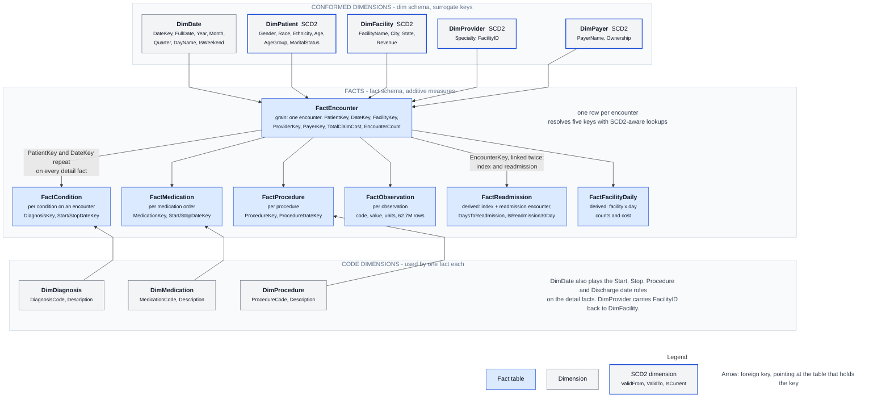

# Data model

The diagram source is [architecture/data-model.mmd](../architecture/data-model.mmd); the column-level entity-relationship diagram with every key is [architecture/data-model-erd.mmd](../architecture/data-model-erd.mmd). Column-level detail for every warehouse table, with row counts and verified relationships, is in [warehouse-data-dictionary.md](warehouse-data-dictionary.md).

## Bronze to Silver mapping

| Bronze table | Silver table | Key | Key origin |
|---|---|---|---|
| bronze_patients | clinical.Patient | PatientID | Source `ID` |
| bronze_encounters | clinical.Encounter | EncounterID | Source `ID` |
| bronze_conditions | clinical.Condition | ConditionID | Generated: SHA-256(PatientID, EncounterID, ConditionCode, StartDate, StopDate) |
| bronze_procedures | clinical.Procedure | ProcedureID | Generated: SHA-256(PatientID, EncounterID, ProcedureCode, ProcedureDate) |
| bronze_medications | clinical.Medication | MedicationID | Generated: SHA-256(PatientID, EncounterID, MedicationCode, StartDate, StopDate) |
| bronze_observations | clinical.Observation | ObservationID | Generated: SHA-256(PatientID, EncounterID, ObservationCode, ObservationDate, ObservationValue, Units) |
| bronze_organizations | reference.Facility | FacilityID | Source `Id` |
| bronze_providers | reference.Provider | ProviderID | Source `Id` |
| bronze_payers | reference.Payer | PayerID | Source `Id` |
| bronze_rural_urban_2023 | population.RuralUrban | RuralUrbanID | Generated: SHA-256(FIPS, Attribute) |
| bronze_usda_income | population.USDAIncome | FIPS | Source |
| bronze_usda_jobs | population.usda_job | FIPS | Source |
| bronze_usda_people | population.USDAPeople | FIPS | Source |

Silver also standardizes names (`BIRTHDATE` to `BirthDate`), types (dates parsed, counts to long, rates to double), and values (gender to Male, Female, Unknown; city title case; state upper case), and derives `Age` and `AgeGroup` for patients and `NumericValue` for observations.

## Gold dimensions

| Table | Grain | Key | Type | Tracked attributes (SCD2) |
|---|---|---|---|---|
| dim.DimDate | one row per day, 1911 to 2035 | DateKey (yyyyMMdd) | Static | |
| dim.DimPatient | one row per patient version | PatientKey | SCD2 | MaritalStatus |
| dim.DimFacility | one row per facility version | FacilityKey | SCD2 | name, address, city, state, zip, coordinates, phone |
| dim.DimProvider | one row per provider version | ProviderKey | SCD2 | facility, address, city, state, zip, coordinates |
| dim.DimPayer | one row per payer version | PayerKey | SCD2 | name, ownership, address, city, state, zip, phone |
| dim.DimDiagnosis | one row per code | DiagnosisKey | Type 1 | |
| dim.DimMedication | one row per code | MedicationKey | Type 1 | |
| dim.DimProcedure | one row per code | ProcedureKey | Type 1 | |

## Gold facts

| Table | Grain | Rows (2026-10-09) |
|---|---|---|
| fact.FactEncounter | one row per encounter | 15,090,025 |
| fact.FactCondition | one row per condition record | 5,809,954 |
| fact.FactMedication | one row per medication order | 4,781,873 |
| fact.FactProcedure | one row per procedure | 7,500,040 |
| fact.FactObservation | one row per observation | 62,658,749 |
| fact.FactReadmission | one row per index encounter with a later encounter | 13,581,912 |
| fact.FactFacilityDaily | one row per facility per day | 0 (awaits facility keys) |

## Surrogate keys

Every dimension key is a `BIGINT` assigned as `MAX(existing key) + ROW_NUMBER() OVER (ORDER BY business key)` at load time. Facts store surrogate keys only; business IDs are kept on the fact for traceability but are not used in relationships. `DateKey` is the integer `yyyyMMdd` form of the date so it is readable and sortable.

## SCD Type 2

Pattern used on the four historized dimensions, with one load timestamp for the whole run:

1. Expire the current row where a tracked attribute differs from the source: set `ValidTo` to the load time and `IsCurrent` to 0.
2. Update non-tracked attributes in place on the rows that are still current.
3. Insert a new row for every business key that no longer has a current row, which covers both new members and changed members. `ValidFrom` is the load time, `ValidTo` is 9999-12-31, `IsCurrent` is 1.
4. Validate that no business key has more than one current row.

Facts resolve the patient key with an SCD2-aware lookup: prefer the version whose validity window contains the event date, then the current version, then the latest historical version.

## Readmission model

Admission and discharge dates and encounter class are not present in the source, so `FactReadmission` uses a documented proxy: for each patient, encounters are ordered by date and each encounter is paired with the next one using `LEAD`. Pairs more than zero days apart are kept; `IsReadmission30Day` is set when the gap is 1 to 30 days. The rate is `# 30-Day Readmissions / # Index Encounters`. Every measure and visual that uses it says it is a proxy.

## Semantic model additions

On top of the warehouse schema the semantic model adds: a dedicated `Health Measures` table, a second Direct Lake source for the Silver `dq` tables (`DQRun`, `DQResult`, `DQRule`), `PipelineRun` and `SourceConfig` from the warehouse, a `FactReadmission` to `DimDate` relationship, a marked date table with sort-by columns, and 70+ measures. See [../semantic-model/README.md](../semantic-model/README.md).
