# Data quality

## Principles

- Invalid records are quarantined, never silently deleted.
- Blocking rules run inside the Silver loader so a bad row cannot reach Silver. A separate audit notebook measures and reports; it never changes data.
- Every rule has an ID, a severity, a type, and a flag for whether it blocks.
- Results are stored as data and surfaced in the report, so quality is visible to the same audience as the metrics.

```mermaid
%%{init: {"flowchart": {"curve": "linear", "wrappingWidth": 360, "nodeSpacing": 30, "rankSpacing": 50}}}%%
flowchart LR
    A[("<b>Bronze table</b><br/><small>one entity</small>")] --> B[Rename, cast, standardize]
    B --> C["<b>Build deterministic ID</b><br/><small>SHA-256 of business columns<br/>when the source has no ID</small>"]
    C --> D["<b>keep_latest</b><br/><small>newest ingestion per key</small>"]
    D --> E{"<b>Blocking rules</b><br/><small>DQ001-DQ010 and<br/>DQ_ENTITY validation</small>"}
    E -- valid --> F["<b>Referential check</b><br/><small>PatientID exists in Silver Patient<br/>DQ004 / DQ007</small>"]
    F -- valid --> G[(Silver table<br/>Delta MERGE on key)]
    E -- invalid --> H[(quarantine.Entity<br/>RuleID, Severity, FailureReason,<br/>RunID, FailureTimestamp)]
    F -- orphan --> H

    G --> I["<b>HP_06_02 audit</b><br/><small>same PipelineRunId</small>"]
    H --> I
    I --> J[(dq.Result<br/>one row per applicable rule:<br/>RecordsChecked, RecordsFailed, FailurePct)]
    I --> K[(dq.RejectedRecord<br/>central JSON copy of each rejected row)]
    I --> L[(dq.Run<br/>TotalRecords, ValidRecords,<br/>RejectedRecords, DQScore)]
    J --> M["<b>HP_10 semantic model</b><br/><small>DQRun, DQResult, DQRule tables</small>"]
    L --> M
    M --> N["<b>HP_11 report</b><br/><small>Data Quality & Pipeline Health page</small>"]

    G --> O[HP_07 Gold loads]
    O --> P["<b>HP_07_04 Gold checks</b><br/><small>grain, completeness, uniqueness,<br/>SCD2, referential integrity</small>"]
    P --> Q[(HP_09_WH_DataQuality<br/>SilverToGoldDQRun / Result)]

    classDef code fill:#f3f4f6,stroke:#6b7280,color:#111827
    classDef store fill:#dbeafe,stroke:#1d4ed8,color:#111827
    classDef gate fill:#fffbeb,stroke:#d97706,color:#111827
    classDef reject fill:#fee2e2,stroke:#b91c1c,color:#111827
    classDef serve fill:#dbeafe,stroke:#1d4ed8,stroke-width:2px,color:#111827
    class B,C,D,I,O,P code
    class A,G,J,K,L,Q store
    class E,F gate
    class H reject
    class M,N serve
```

The diagram source is [architecture/data-quality-flow.mmd](../architecture/data-quality-flow.mmd).

## Layer 1: Bronze to Silver

### Rule catalogue (`dq.Rule`, 22 rules)

| Rule | Entity | Check | Severity | Type | Blocks |
|---|---|---|---|---|---|
| DQ001 | Patient | PatientID not null | CRITICAL | COMPLETENESS | yes |
| DQ002 | Patient | BirthDate on or before today | ERROR | VALIDITY | yes |
| DQ003 | Patient | DeathDate on or after BirthDate | ERROR | VALIDITY | yes |
| DQ004 | Encounter | PatientID exists in Silver Patient | ERROR | REFERENTIAL_INTEGRITY | yes |
| DQ005 | Encounter | StartTime on or before EndTime | ERROR | VALIDITY | not applicable: source has no times |
| DQ006 | Encounter | Cost not negative | ERROR | VALIDITY | not applicable: source has no cost |
| DQ007 | Observation | PatientID exists in Silver Patient | ERROR | REFERENTIAL_INTEGRITY | yes |
| DQ008 | Encounter | FacilityID exists in Silver Facility | ERROR | REFERENTIAL_INTEGRITY | not applicable: source has no facility |
| DQ009 | Patient | Gender in M, MALE, F, FEMALE | WARNING | DOMAIN | no, logged only |
| DQ010 | Encounter | EncounterID unique, newest kept | CRITICAL | UNIQUENESS | yes |
| DQ_FACILITY ... DQ_USDA_PEOPLE | one per entity | Required fields present, dates valid, numeric ranges plausible | ERROR | VALIDITY | yes |

### Quarantine

`quarantine.<Entity>` holds the full rejected row plus `RuleID`, `Severity`, `FailureReason`, `RunID`, `FailureTimestamp`. `dq.RejectedRecord` holds a central copy of every rejected row as JSON with its key, so one table answers "what was rejected and why" across entities.

### Score

`DQScore = ValidRecords / TotalRecords * 100` per entity per pipeline run, stored in `dq.Run`.

### Measured results (Silver, as of 2026-10-09)

27 entity runs across 3 pipeline runs. 144.5 million records evaluated, 45.4 million rejected.

| Entity | Records checked | Rejected | Score |
|---|---|---|---|
| Observation | 62,741,008 | 82,259 | 99.9 |
| Encounter | 60,437,708 | 45,347,683 | 62.5 |
| Procedure | 7,500,040 | 0 | 100 |
| Condition | 5,809,954 | 0 | 100 |
| Medication | 4,781,956 | 83 | 100.0 |
| Patient | 3,187,734 | 2 | 100.0 |
| USDAPeople | 3,280 | 2,917 | 55.5 |
| Facility, Provider, Payer, RuralUrban, USDAIncome, usda_job | 6,888 and below | 0 | 100 |

Where the rejections come from:

| Rule | Records failed | Interpretation |
|---|---|---|
| DQ010 duplicate EncounterID | 45,328,281 | The same encounter file was ingested in several pipeline runs because the incremental watermark is never persisted. The rule kept the newest copy and quarantined the rest. The framework worked; the fix is upstream in the loader. |
| DQ007 observation patient missing | 82,259 | Observations for patients that failed their own rules or were not loaded. |
| DQ004 encounter patient missing | 19,402 | Same cause for encounters. |
| DQ009 gender outside domain | 7,066 | Warning only. |
| DQ_USDA_PEOPLE validation | 2,917 of 3,280 | Most county rows fail a 0 to 100 percentage rule on at least one of 25 percentage columns. The rule set is stricter than the source; worth reviewing which column trips it. |

## Layer 2: Silver to Gold

`HP_07_04_NB_SilverToGold_DQ` runs 28 checks after every warehouse load and writes them to `HP_09_WH_DataQuality`. Check shape: a `UNION ALL` of small queries per table, each inserted with PASS or FAIL and the failed and total counts. The run status is FAILED if any critical check failed.

| Table | Checks |
|---|---|
| DimDate | DateKey populated, DateKey unique, FullDate unique |
| DimPatient | PatientID populated, one current row per patient, ValidTo after ValidFrom |
| DimFacility, DimProvider, DimPayer | ID populated, one current row per member |
| DimDiagnosis, DimMedication | code populated, code unique |
| FactEncounter | one row per EncounterID, PatientKey and DateKey populated, PatientKey exists in DimPatient, measures non-negative |
| FactCondition | one row per ConditionID, PatientKey populated, DiagnosisKey populated |
| FactReadmission | keys populated, DaysToReadmission positive |

### Measured results (latest run, 2026-10-08)

28 checks, 27 passed, 1 failed: `FactCondition.PatientKey populated`, 7,697 of 5,809,954 rows. These are conditions whose encounter and patient both failed to resolve. The run is correctly marked FAILED because the failing check is critical.

## Gaps and next steps

- Add Gold checks for FactMedication, FactProcedure, FactObservation, and for the null facility, provider, and payer keys on FactEncounter.
- Persist the incremental watermark so DQ010 stops absorbing re-ingested duplicates.
- Review the USDA People percentage rule against the source definitions.
- Add a Silver rule for the malformed Race values.
