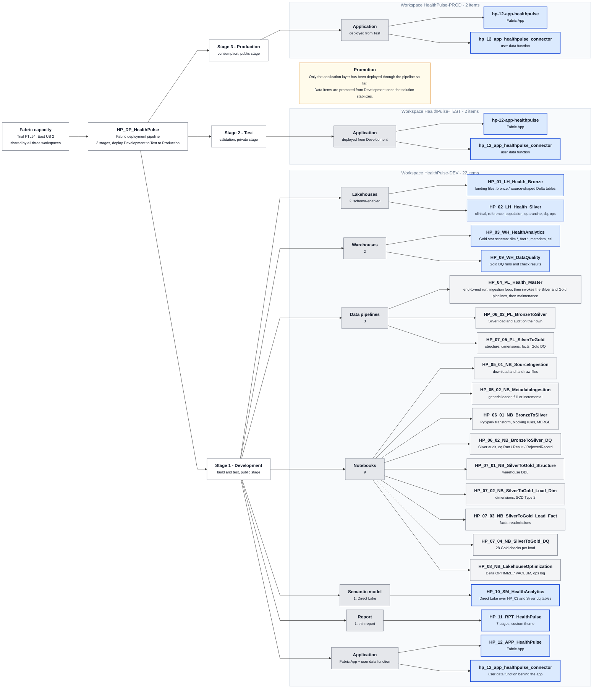

# Deployment and environments

## Workspaces

| Workspace | Role | Current contents |
|---|---|---|
| HealthPulse-DEV | Build and test | All 22 items: lakehouses, warehouses, notebooks, pipelines, semantic model, report, app, data function |
| HealthPulse-TEST | Validation | Fabric App backend and its data function |
| HealthPulse-PROD | Consumption | Fabric App backend and its data function |

All three run on the same Fabric capacity.

The diagram shows the capacity, the deployment pipeline and its stages, and every item in each workspace. Its source is [architecture/solution-structure.mmd](../architecture/solution-structure.mmd).

## Deployment pipeline

`HP_DP_HealthPulse` has three stages, Development, Test, Production, mapped to the three workspaces. The application layer has been promoted through all stages; the data items are promoted as the DEV solution stabilizes. Promotion is selective per item, so a semantic model change can move without re-deploying notebooks.

## What is parameterized

- Notebooks resolve lakehouse and warehouse names from constants at the top of each notebook (`BRONZE_LAKEHOUSE`, `SILVER_LAKEHOUSE`) and from attached default items, so the same notebook runs in any workspace once attachments are rebound.
- Pipelines reference notebooks by item ID; deployment pipeline rules rebind them per stage.
- The semantic model's two Direct Lake expressions hold the workspace and item IDs of the warehouse and the Silver lakehouse; these are the values to override with deployment rules per stage.
- The report is a thin report bound to the semantic model by name and workspace.

## Source control

This repository holds the notebooks, pipeline definitions, warehouse SQL, semantic model TMDL, and report PBIP. The intended workflow is Fabric Git integration on the DEV workspace against a `dev` branch, pull requests into `main`, and promotion through the deployment pipeline. Until Git integration is connected, definitions are exported with the Fabric REST API and committed here.

## Failure handling and re-runs

- The ingestion loader returns row counts even on empty loads and the pipeline logs every activity, so a failed or empty source is visible in `etl.PipelineRun`.
- Silver loads are MERGE-based and the DQ audit deletes its own rows for a run before writing, so re-running a run ID is safe.
- Gold loads are update-then-insert keyed on business IDs, so a partial run can be repeated.
- Gold DQ marks a run FAILED on any critical failure so promotion can be gated on it.
