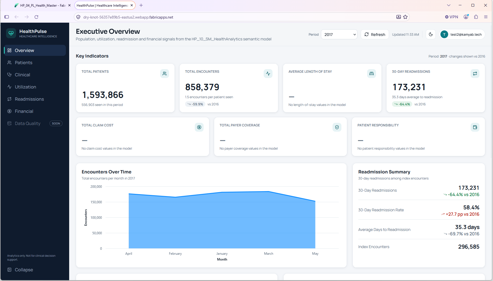

# Fabric App: HP_12_APP_HealthPulse

## What exists

- `HP_12_APP_HealthPulse`, an `AppBackend` item in HealthPulse-DEV (the item type reported by the Fabric REST API).
- `hp_12_app_healthpulse_connector`, a Fabric User Data Function that serves as the app's data connector and reads `HP_10_SM_HealthAnalytics`.
- Both items are deployed to HealthPulse-TEST and HealthPulse-PROD through the deployment pipeline, where the app is listed as `hp-12-app-healthpulse`.
- A hosted web front end on a `*.webapp.fabricapps.net` address in East US 2, opened with the same Fabric sign-in.

## What the app shows

Captured on 2026-10-11 from the hosted front end.

Navigation: Overview, Patients, Clinical, Utilization, Readmissions, Financial, and Data Quality (marked "Soon").

The Executive Overview page has:

- A header with the page title, a subtitle naming the semantic model, a **Period** selector (year), a **Refresh** button with the last-updated time, a dark-mode toggle, and the signed-in account.
- **Key indicators**, seven cards. Total Patients, Total Encounters (with encounters per patient and the change versus the prior year) and 30-Day Readmissions (with average days to readmission and the change versus the prior year) carry values. Average Length of Stay, Total Claim Cost, Total Payer Coverage and Patient Responsibility show a dash and the text "No ... values in the model". Those columns are null in `FactEncounter` (see [data-quality.md](data-quality.md)); the app says so instead of showing zeros.
- **Encounters Over Time**, an area chart of monthly encounters for the selected year.
- **Readmission Summary**: 30-day readmissions, 30-day readmission rate, average days to readmission and index encounters, each with the change versus the prior year.
- A footer disclaimer: "Analytics only. Not for clinical decision support."

Values shown for period 2017 in the screenshot:

| Indicator | Value |
|---|---|
| Total patients | 1,593,866 (556,903 seen in the period) |
| Total encounters | 858,379, 1.5 per patient seen |
| 30-day readmissions | 173,231 |
| 30-day readmission rate | 58.4% |
| Average days to readmission | 35.3 |
| Index encounters | 296,585 |

2017 is a partial year (encounters end on 2017-05-28), so the large negative changes versus 2016 are an artefact of the period, not a trend. 2016 is the last complete year and the one the report defaults to.

## The same item inside Fabric

Opening `HP_12_APP_HealthPulse` in the Fabric portal presents the seven pages of `HP_11_RPT_HealthPulse` in the app's left navigation, with Copilot and a "Go back" link. The Power BI report and the web front end are two faces of the same app: the report for analysts in Fabric, the web app for a wider audience.

## Role in the architecture

The app is the advanced presentation layer and is deliberately kept independent of the core platform. Lakehouse, warehouse, semantic model, and report work without it. The app reads curated results through the data function, so it never touches Bronze or Silver directly.

## Observations to fix

- The month axis of Encounters Over Time is sorted alphabetically (April, February, January, March, May). Sort by month number.
- The period defaults to 2017, a partial year. Default to 2016 to match the report's filter.
- The Data Quality page is a placeholder; the Silver `dq` tables are already in the semantic model, so the page can be built on the same measures as the report's Data Quality & Pipeline Health page.

## To document next

- Screenshots of the Patients, Clinical, Utilization, Readmissions and Financial pages.
- The data function's signature and the DAX it runs.
- How authentication flows from the app to the function to the semantic model.
