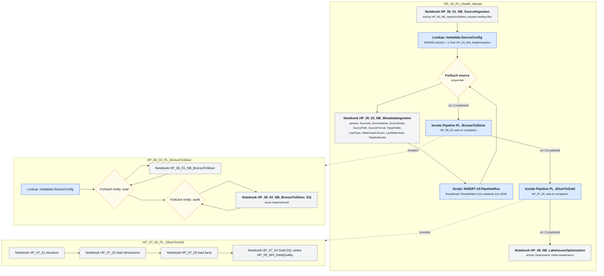
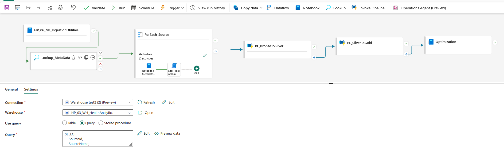
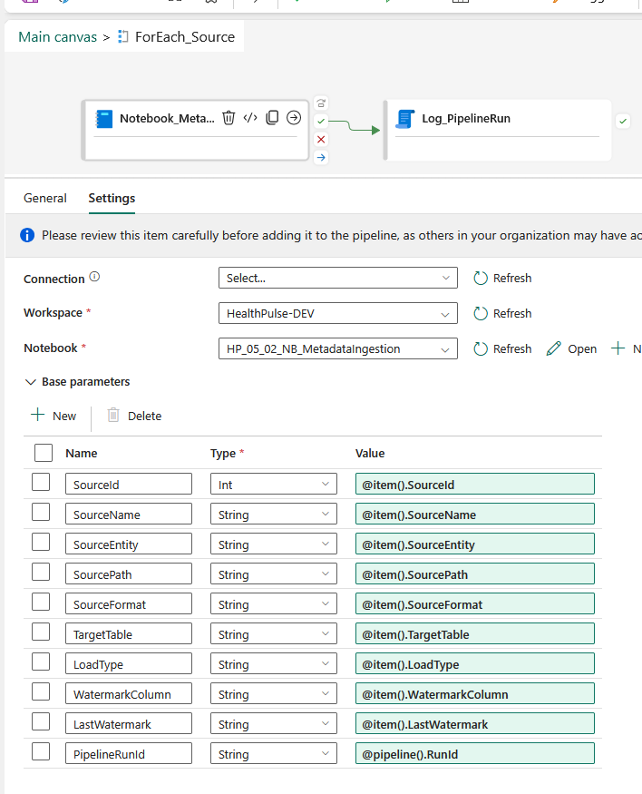
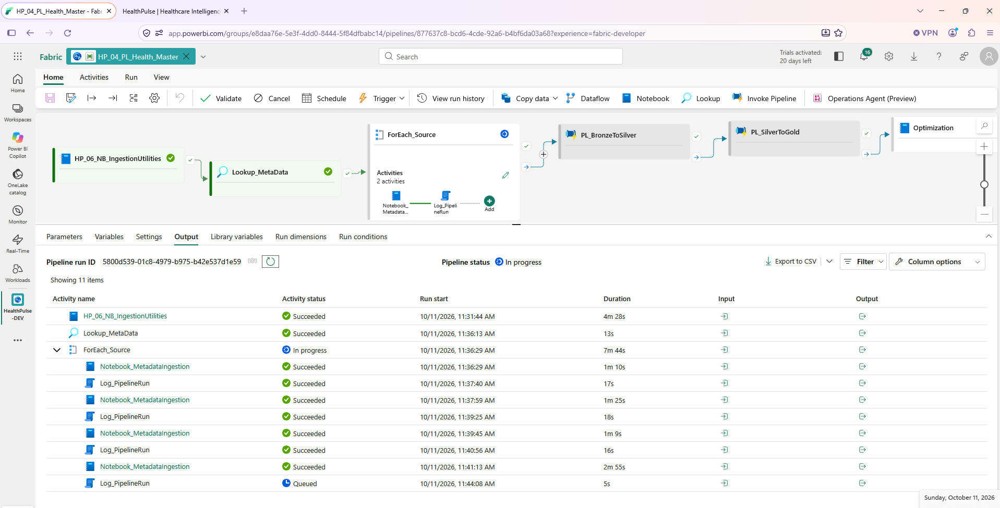
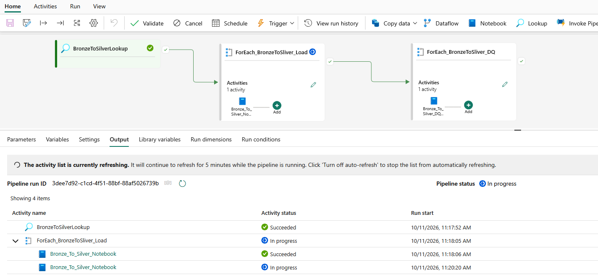
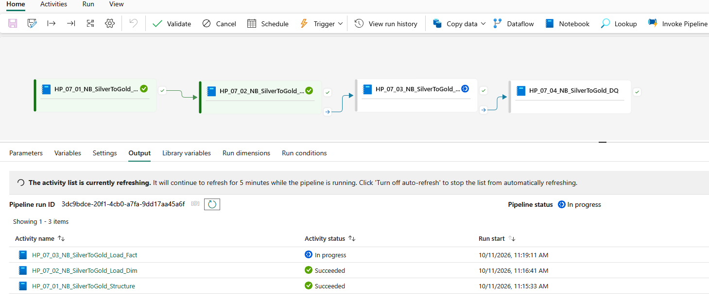

# Pipelines

Three Fabric Data Factory pipelines orchestrate the platform; the master invokes the other two. Their exported definitions, refreshed from the live workspace on 2026-10-11, are in [exports/](exports/). The flow is drawn below; the diagram source is [architecture/pipeline-orchestration.mmd](../architecture/pipeline-orchestration.mmd).



## HP_04_PL_Health_Master

The metadata-driven entry point and, since the redesign captured on 2026-10-11, the one pipeline that runs the whole platform end to end. One pipeline loads every source because the list of sources lives in a table, not in the pipeline. It then invokes the Silver and Gold pipelines and finishes with Delta maintenance.



1. **Notebook** activity `HP_06_NB_IngestionUtilities` runs `HP_05_01_NB_SourceIngestion` (the activity keeps an older name) to prepare the landing folders and raw files.
2. **Lookup** `Lookup_MetaData` reads `metadata.SourceConfig WHERE IsActive = 1 ORDER BY SourceId` from `HP_03_WH_HealthAnalytics` in query mode.
3. **ForEach** `ForEach_Source` (sequential) over the returned rows:
   - **Notebook** `Notebook_MetadataIngestion` runs `HP_05_02_NB_MetadataIngestion` with ten base parameters: every column of the row mapped from `@item()`, plus `PipelineRunId = @pipeline().RunId`. The notebook exits with JSON `{RowsRead, RowsWritten, RowsRejected}`.
   - **Script** `Log_PipelineRun` inserts one row into `etl.PipelineRun` using the pipeline run ID, trigger time, current time, status, and the row counts parsed from the notebook's exit value.
4. **Invoke Pipeline** `PL_BronzeToSilver` runs `HP_06_03_PL_BronzeToSilver` and waits for it to complete.
5. **Invoke Pipeline** `PL_SilverToGold` runs `HP_07_05_PL_SilverToGold` and waits for it to complete.
6. **Notebook** `Optimization` runs `HP_08_NB_LakehouseOptimization` for Delta maintenance.

Steps 4 to 6 depend on the previous step with the **Completed** condition rather than **Succeeded**, so a failed source load does not stop the Silver and Gold stages; the failure stays visible in the run history and in `etl.PipelineRun`. Change the condition to Succeeded if a hard stop is preferred.



### Run evidence, 2026-10-11



| Activity | Duration |
|---|---|
| Ingestion utilities notebook | 4 min 28 s |
| Lookup | 13 s |
| Loader notebook, per source | 1 min 09 s to 2 min 55 s |
| Log script, per source | 16 to 18 s |

The run started at 11:31 and was still inside the loop at 11:44 after four of thirteen sources. The child pipeline runs in the screenshots below were started by hand earlier the same morning (`3dee7d92` at 11:17 and `3dc9bdce` at 11:15).

### Control table

```sql
CREATE TABLE metadata.SourceConfig
(
    SourceId        INT           NOT NULL,
    SourceName      VARCHAR(100),
    SourceEntity    VARCHAR(100),
    SourcePath      VARCHAR(500),
    SourceFormat    VARCHAR(20),
    TargetTable     VARCHAR(100),
    LoadType        VARCHAR(30),      -- Full | Incremental
    WatermarkColumn VARCHAR(100),     -- source column for incremental loads
    LastWatermark   DATETIME2(6),
    IsActive        BIT
);
```

Thirteen rows are configured: nine Synthea entities and four USDA entities. Adding a source is a new row; no pipeline or notebook changes.

### Run log

```sql
CREATE TABLE etl.PipelineRun
(
    RunID           VARCHAR(100),
    PipelineName    VARCHAR(100),
    EntityName      VARCHAR(100),
    StartTime       DATETIME2(6),
    EndTime         DATETIME2(6),
    Status          VARCHAR(30),
    RowsRead        BIGINT,
    RowsWritten     BIGINT,
    RowsRejected    BIGINT,
    DurationSeconds INT,
    ErrorMessage    VARCHAR(4000),
    BatchID         VARCHAR(100)
);
```

As of 2026-10-09 the log holds 201 activities across 18 runs, 1.50 billion rows written, zero rejected, all SUCCESS. The report's Data Quality & Pipeline Health page reads this table directly.

## HP_06_03_PL_BronzeToSilver

Runs the Silver layer on its own, for example after a rule change. The master pipeline invokes it after the ingestion loop.



1. **Lookup** the same control table.
2. **ForEach** entity: notebook `HP_06_01_NB_BronzeToSilver`.
3. **ForEach** entity again: notebook `HP_06_02_NB_BronzeToSilver_DQ` with the same `PipelineRunId`, so the audit sees exactly the rows the loader just wrote.

The two loops are deliberately separate so every entity is loaded before any referential check runs against Silver Patient.

## HP_07_05_PL_SilverToGold

Four notebooks in strict sequence: structure, dimensions, facts, Gold data quality. Each depends on the previous one having finished; the fact and DQ steps use the Completed condition so the checks still run after a partial fact load. The master pipeline invokes it after the Silver pipeline.



The activity names in the Silver pipeline spell `BronzeToSliver`; the typo is in the live item and is kept as is in the export.

## Load patterns demonstrated

| Pattern | Where |
|---|---|
| Full load, overwrite | Reference entities (organizations, providers, payers, USDA tables) |
| Incremental load with watermark column | encounters, conditions, observations, procedures, medications |
| Metadata-driven fan-out | `ForEach` over `SourceConfig` in both ingestion pipelines |
| Parent-child orchestration | `Invoke Pipeline` activities in the master call HP_06_03 and HP_07_05 and wait for completion |
| Run logging from notebook exit values | `Log_PipelineRun` script activity |
| Idempotent re-runs | Delta MERGE in Silver, update-then-insert in Gold, DQ audit deletes its own prior rows for the run |

## Known limitation

The incremental loader computes a new watermark but the pipeline never writes it back to `SourceConfig.LastWatermark`, so each incremental run re-reads the full file. Silver deduplication absorbs the duplicates, at the cost of 45 million quarantined encounter rows. Persisting the watermark is the first item on the roadmap.
