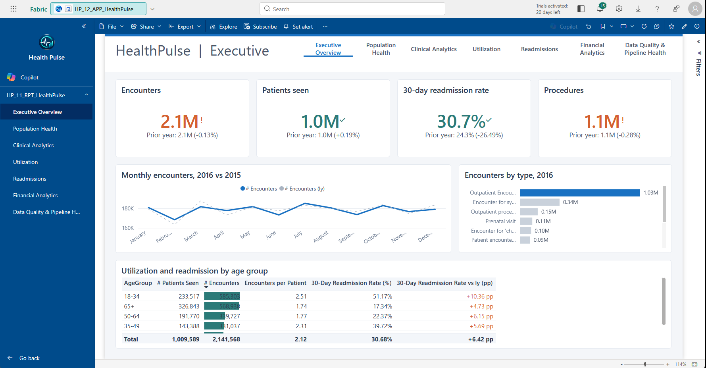

# Power BI report: HP_11_RPT_HealthPulse

The report source is in PBIP format: [HP_11_RPT_HealthPulse.pbip](HP_11_RPT_HealthPulse.pbip) and the [HP_11_RPT_HealthPulse.Report](HP_11_RPT_HealthPulse.Report/) folder with one JSON file per page and visual. It is a thin report connected live to `HP_10_SM_HealthAnalytics`. Open the `.pbip` in Power BI Desktop or publish it with `pbir publish`.

## Design

- 1280 x 720 canvas, 24 px margins, 16 px gaps, consistent rows on every page.
- A header band on every page: title, a muted context line, and a seven-tab page navigator.
- Custom theme `HealthPulse`: one accent blue, grey secondaries, accessible teal and rust for good and bad, Segoe UI, hairline card borders, no shadows.
- KPIs show the selected year against the prior year as the goal, with the gap as a percentage. Bar charts highlight only the top category. Line charts draw prior year as a thin dashed grey line. Tables use data bars on the primary measure and colour only variance columns.
- Titles are question-shaped and several are dynamic: "Monthly encounters, 2016 vs 2015" follows the year filter.
- Every data visual has alt text.

## Pages

| Page | Question it answers | Main visuals |
|---|---|---|
| Executive Overview | Where do we stand this year versus last | 4 KPIs, monthly encounters vs prior year, encounters by type, utilization and readmission by age group |
| Population Health | Who are we serving | Registered patients, average age, encounters per patient, active conditions; patients by age and gender, marital status, ethnicity, race |
| Clinical Analytics | Which diagnoses, procedures, and medications drive volume | Three ranked bars, diagnosis by age-group heatmap |
| Utilization | How is demand distributed over time | 4 KPIs, encounters by weekday, by quarter vs prior year, encounter type by age-group heatmap |
| Readmissions | Which groups and months need attention | 4 KPIs, monthly readmission rate vs prior year, rate by gender, triage table by age group |
| Financial Analytics | What does care cost and who pays | Cost cards, monthly claim cost, cost by encounter type, cost and length of stay by age group (fills once source columns are populated) |
| Data Quality & Pipeline Health | Can the data be trusted and did the pipeline run | DQ score and failed rules for the latest run, records rejected, pipeline success rate, failing rules table, DQ score by entity, pipeline activity by entity |

A report-level filter sets the year to 2016, the last complete year, and can be changed in the filter pane. The Data Quality page is not affected by the year filter.

## Honest labelling

Readmission measures use the notebook's proxy definition (any later encounter within 30 days). Financial and length-of-stay visuals are blank until the fact load maps those source columns. Both facts are stated on the page itself.
